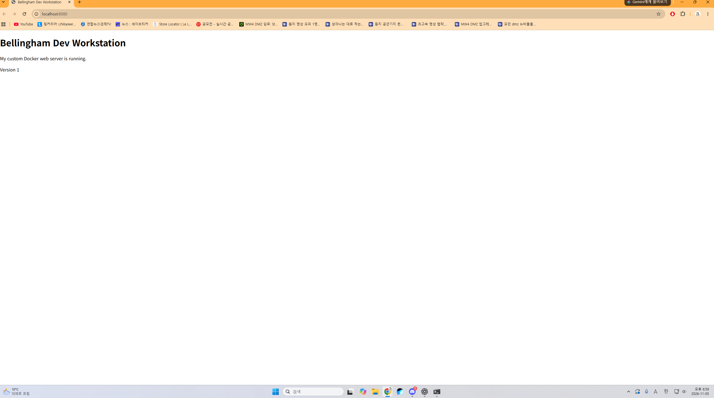
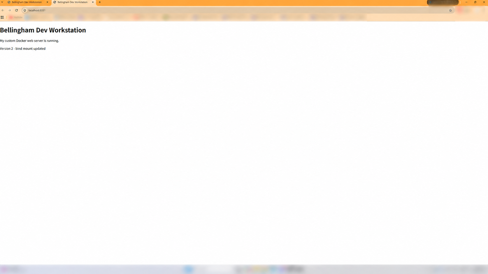
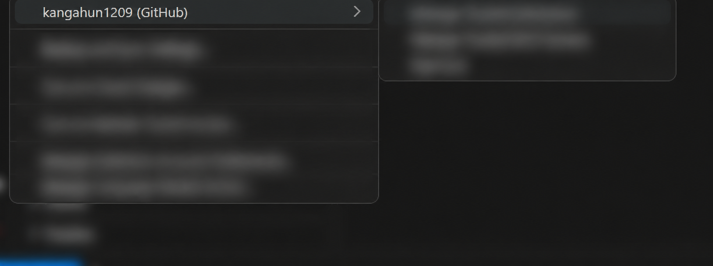

# 개발자용 작업실 구축

## 1. 프로젝트 개요
WSL Ubuntu에서 터미널 기본 조작과 권한 변경을 실습하고,
Docker 커스텀 웹 서버, 포트 매핑, 바인드 마운트 및 볼륨 영속성을 검증했다.
Git으로 소스를 관리하고 VS Code를 GitHub 계정에 연결했다.

## 2. 실행 환경
- 호스트: Windows + WSL2
- OS: Ubuntu 26.04.1 LTS
- Shell: Bash (/bin/bash)
- Git: 2.53.0
- Docker: 29.9.2
- 편집기: VS Code (WSL: Ubuntu)

호스트 Ubuntu와 실습용 ubuntu:24.04 컨테이너는 서로 다른 환경이다.
작업 경로는 ~/dev-workstation이며, 다른 PC에서는 저장소를 복제한 경로를 사용한다.
Docker Desktop 실행 및 해당 Ubuntu 배포판의 WSL Integration 활성화가 필요하다.

## 3. 수행 체크리스트
- [x] 터미널 파일·디렉터리 기본 조작
- [x] 파일과 디렉터리 권한 변경 전후 비교
- [x] Docker 버전 및 데몬 확인
- [x] hello-world 실행
- [x] Ubuntu 컨테이너 내부 명령 실행
- [x] 기본 셸 종료와 exec 셸 종료의 차이 확인
- [x] 이미지·컨테이너 목록, 중지, 로그, 리소스 확인
- [x] Dockerfile 작성 및 커스텀 이미지 빌드
- [x] 포트 매핑과 웹 접속
- [x] 바인드 마운트 변경 반영
- [x] 볼륨 데이터 영속성 확인
- [x] Git 사용자 및 기본 브랜치 설정
- [x] VS Code WSL 연결 및 GitHub 로그인
- [x] GitHub 저장소 업로드 및 증거 이미지 첨부

## 4. 수행 로그 및 증거
입력 명령과 실제 출력은 [터미널 로그](logs/terminal.log)에 기록했다.
로그에는 터미널 색상·제어 문자가 포함될 수 있다.
브라우저 접속 및 VS Code 연동 화면은 아래 11절에 첨부했다.

| 항목 | 검증 방법 | 확인 결과 |
|---|---|---|
| 기본 조작 | pwd, ls -la, mkdir, cd, touch, echo, cat, cp, mv, rm | 파일 생성·복사·이름 변경·삭제 |
| 권한 | chmod, ls -ld | 파일 600→644, 디렉터리 700→755 |
| Docker 점검 | docker --version, docker info | 버전 및 서버 정보 출력 |
| 기본 실행 | docker run hello-world | Hello from Docker! |
| 컨테이너 종료 | bash에서 exit 후 docker ps -a | workstation-ubuntu가 Exited |
| exec 종료 | sleep infinity 컨테이너에 exec 후 exit | 기본 프로세스가 살아 있어 Up 유지 |
| 운영 | docker images, ps -a, logs, stats --no-stream, stop | 목록·로그·리소스·중지 확인 |
| 웹 서버 | docker build, docker run, curl -i | 직접 작성한 HTML 응답 |
| 바인드 마운트 | 호스트 HTML 변경 후 curl | Version 1→Version 2 |
| 볼륨 | 컨테이너 삭제·재생성 후 cat | 동일한 데이터 유지 |

## 5. 커스텀 이미지
공식 nginx:alpine을 베이스로 선택했다.
NGINX의 정적 웹 서버 기능을 활용하고 직접 작성한 HTML로 기본 페이지를 교체했다.

- FROM: 웹 서버 베이스 이미지 선택
- LABEL: 이미지 목적 기록
- COPY: 웹 페이지를 이미지에 포함
- EXPOSE: 컨테이너가 사용하는 80 포트 명시
- EXPOSE만으로 호스트 포트가 공개되지는 않으며 실행 시 -p가 필요하다.

### 빌드와 실행
새 환경에서 아래 명령을 순서대로 실행한다.
동일한 이름의 컨테이너나 포트가 이미 있으면 기존 상태를 확인한 뒤 다른 이름·포트를 사용한다.

```bash
docker build -t bellingham-web:1.0 .
docker run -d --name bellingham-web-8080 \
  -p 127.0.0.1:8080:80 bellingham-web:1.0
curl -i http://localhost:8080
docker logs bellingham-web-8080
```

브라우저 주소: http://localhost:8080

이미지는 빌드 시점의 파일을 복사한다.
저장소의 HTML은 바인드 마운트 실습으로 Version 2로 변경됐으므로,
새로 빌드하면 Version 2가 포함된다. 최초 실습 이미지는 Version 1이었다.

## 6. 바인드 마운트 검증
저장소 루트에서 실행한다.
호스트의 site 디렉터리를 컨테이너의 웹 루트에 읽기 전용으로 연결한다.

```bash
docker run -d --name bellingham-web-8081 \
  -p 127.0.0.1:8081:80 \
  --mount type=bind,source="$(pwd)/site",target=/usr/share/nginx/html,readonly \
  bellingham-web:1.0
curl -s http://localhost:8081
```

실제 실습에서는 아래 명령으로 Version 1을 Version 2로 변경했다.

```bash
sed -i 's/Version 1/Version 2 - bind mount updated/' site/index.html
curl -s http://localhost:8081
```

이미지 재빌드나 컨테이너 재생성 없이 응답이 변경됐다.
재현 시 이미 Version 2이면 해당 문구를 다른 문구로 바꾸어 전후를 비교한다.
브라우저 주소: http://localhost:8081

## 7. 볼륨 영속성 검증
새 환경에서 실행한다. 삭제 대상은 실습용 컨테이너 1개이며 볼륨은 삭제하지 않는다.

```bash
docker volume create bellingham-data
docker run -d --name bellingham-volume-1 \
  --mount source=bellingham-data,target=/data \
  ubuntu:24.04 sleep infinity
docker exec bellingham-volume-1 bash -c \
  'echo "Bellingham persistent data" > /data/message.txt'
docker exec bellingham-volume-1 cat /data/message.txt
docker rm -f bellingham-volume-1
docker run -d --name bellingham-volume-2 \
  --mount source=bellingham-data,target=/data \
  ubuntu:24.04 sleep infinity
docker exec bellingham-volume-2 cat /data/message.txt
```

실제 삭제 전과 새 컨테이너에서 동일한 출력이 확인됐다.

```text
Bellingham persistent data
```

볼륨은 컨테이너와 독립적으로 유지되는 저장소다.
바인드 마운트는 호스트의 지정 경로를 직접 연결한다.

## 8. 핵심 개념
- 절대 경로: /home/bellingham/dev-workstation처럼 루트부터 지정한다.
- 상대 경로: 현재 위치를 기준으로 site/index.html처럼 지정한다.
- 권한 r/w/x의 값은 각각 4/2/1이다.
- 644는 소유자 rw-, 그룹 r--, 기타 r--다.
- 755는 소유자 rwx, 그룹 r-x, 기타 r-x다.
- 디렉터리의 x는 진입·경로 탐색, w는 항목 생성·삭제와 관련된다.
- 포트 매핑은 호스트 포트와 컨테이너 포트를 연결한다.
- exec는 실행 중인 컨테이너에 별도 프로세스를 만든다.
- attach는 기존 기본 프로세스의 입출력에 연결한다. 이번에는 직접 실습하지 않았다.
- Git은 로컬 버전 관리 도구이고 GitHub는 원격 저장소·협업 서비스다.

## 9. 트러블슈팅
### 1) Ubuntu에서 Docker 명령을 찾지 못함
- 문제: docker: command not found
- 원인 가설: Docker Desktop과 WSL Ubuntu의 통합이 비활성화됨
- 확인: Windows에는 Docker Desktop이 있으나 Ubuntu에서 명령 인식 실패
- 해결: Docker Desktop의 Ubuntu WSL Integration을 활성화
- 결과: docker --version에서 29.9.2 확인

### 2) Docker 소켓 접근 권한 거부
- 문제: /var/run/docker.sock 연결 시 permission denied
- 원인 가설: 현재 사용자에게 Docker 소켓 접근 그룹 권한이 적용되지 않음
- 확인: 명령은 인식되지만 docker info와 hello-world 실행 실패
- 해결: sudo usermod -aG docker "$USER" 실행 후 Ubuntu 창을 모두 닫고 다시 실행
- 중간 시도: newgrp docker는 명령이 없어 사용할 수 없었음
- 결과: docker run hello-world 성공
- 주의: docker 그룹은 호스트에 강한 권한을 부여하므로 신뢰하는 사용자에게만 부여한다.

### 3) VS Code에서 Git을 찾지 못함
- 문제: Windows 환경으로 WSL 폴더를 열었을 때 Git not found 표시
- 원인 가설: Ubuntu Git이 아닌 Windows 환경에서 Git을 찾음
- 확인: Ubuntu 터미널에는 Git 2.53.0이 설치되어 있음
- 해결: Microsoft WSL 기능으로 연결 후 과제 폴더를 다시 열음
- 결과: WSL: Ubuntu 표시 및 통합 터미널에서 git status 정상 실행

## 10. Git 설정
커밋 작성자와 기본 브랜치를 다음과 같이 설정했다.

```bash
git config user.name "kangahun1209"
git config user.email "352846497+kangahun1209@users.noreply.github.com"
git config --global init.defaultBranch main
git config --list
```

개인 이메일 대신 GitHub에서 제공하는 noreply 주소를 사용했다.
인증 토큰·비밀번호·개인키는 문서에 기록하지 않는다.

## 11. 화면 증거

### 8080 포트 접속


### 8081 포트 및 바인드 마운트 변경 반영


### VS Code GitHub 로그인

